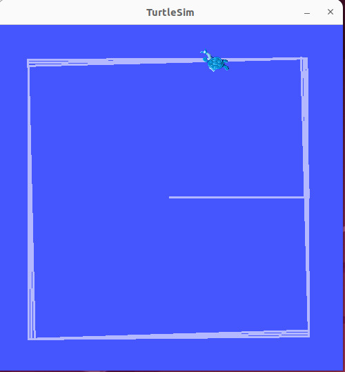
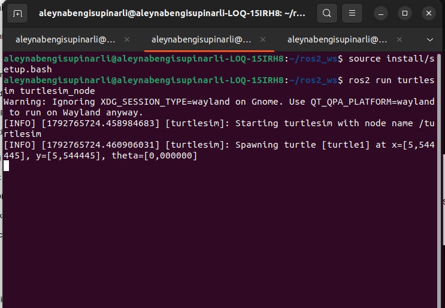
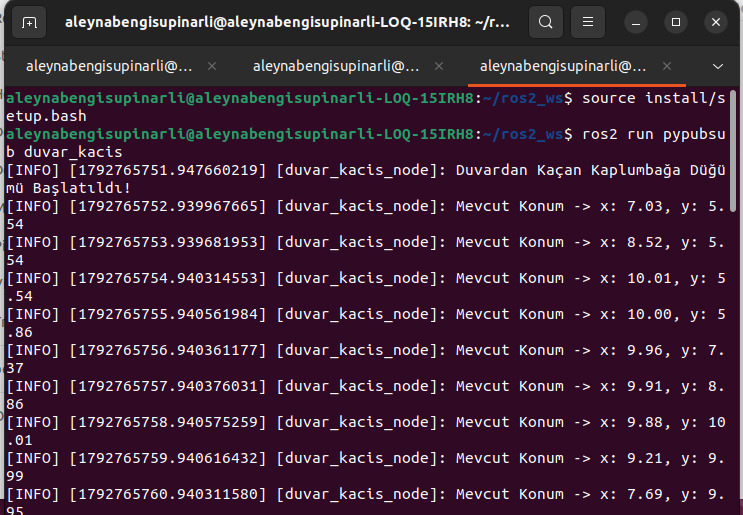

# ROS 2 TurtleSim Otonom Duvar Kaçınma Projesi (`turtle_duvar_py`)

Bu depo, ROS 2 Humble ve Python altyapısı kullanılarak geliştirilmiş otonom bir simülasyon uygulamasıdır. `turtlesim` ortamındaki kaplumbağanın anlık konum verilerini takip ederek sınır çizgilerine çarpmasını önler ve güvenli bir şekilde manevra yapmasını sağlar.

---

## 📌 Temel Özellikler ve Mimari

- **Hibrit Düğüm Yapısı (`duvar_kacis_node`):** Tek bir ROS 2 düğümü içerisinde hem abone (`/turtle1/pose` üzerinden konum takibi) hem de yayıncı (`/turtle1/cmd_vel` üzerinden hareket komutları) mekanizmaları eş zamanlı çalışır[cite: 8].
- **Akıllı Sınır Algoritması:** Kaplumbağa belirlenen güvenli sınırların dışına çıktığında ve yönü duvara dönükse, doğrusal hızı kesilip açısal hızla iç kısımlara doğru döner; böylece köşelerde veya kenarlarda takılıp kalma (daire çizme) problemi ortadan kalkar[cite: 8].
- **Zamanlayıcı Destekli Loglama:** `create_timer` yardımıyla her 1 saniyede bir `get_logger().info()` fonksiyonu tetiklenerek anlık koordinatlar konsola aktarılır[cite: 8].
- **Dinamik Parametre Yönetimi (Bonus):** Hızlar ve çalışma sınırları kod içerisinden bağımsız olarak ROS 2 parametreleri aracılığıyla değiştirilebilir[cite: 8]:

| Parametre Adı | Varsayılan Değer | Açıklama |
| :--- | :--- | :--- |
| `linear_speed` | `1.5` | Standart ileri hareket hızı |
| `angular_speed` | `2.0` | Kaçış anındaki dönüş hızı |
| `min_limit` | `1.0` | Alt koordinat eşiği (X ve Y ekseni) |
| `max_limit` | `10.0` | Üst koordinat eşiği (X ve Y ekseni) |

---

## 🖼️ Sistem Çıktıları ve Görseller

### 1. Simülasyon Ortamı
Aşağıdaki görselde kaplumbağanın simülasyon ortamındaki hareket yörüngesi görülmektedir. Kaplumbağa ekranın ortasından ileri doğru hareket etmeye başlamış, sağ kenarda x ≈ 10.0 sınırına ulaştığında dönerek yön değiştirmiştir. Aynı davranış diğer kenarlarda da tekrar ettiği için kaplumbağa duvara çarpmadan ekranın kenarlarını dolaşmakta, basit sınır kontrollerinde yaşanan köşede takılıp kalma veya daire çizme sorunlarını başarıyla aşmaktadır:



### 2. Simülatör Başlangıç Ekranı
ros2 run turtlesim turtlesim_node komutuyla başlatılan simülatör düğümünün terminal çıktısıdır. Düğüm başlatıldığında kaplumbağa (turtle1) ekranın tam ortasında, yaklaşık x = 5.54, y = 5.54 konumunda ve theta = 0 açısıyla otomatik olarak oluşturulur. Düğümümüz anlık konum verilerini /turtle1/pose topiği üzerinden dinlemeye bu aşamada başlar:



### 3. Konsol Log Akışı
duvar_kacis_node düğümünün terminal çıktısıdır. Düğüm, zamanlayıcı mekanizması sayesinde her saniye [INFO] seviyesinde mevcut konumu konsola yazdırmaktadır. Loglar incelendiğinde kaplumbağanın y ≈ 5.54 sabitken x değerinin 7.01, 8.52 ve 10.01 olarak arttığı, x üst sınıra (10.0) ulaştığında açısal dönüş yaparak yön değiştirdiği ve ardından y değerinin artarak ilerlemeye devam ettiği net bir şekilde görülmektedir. Bu da otonom sınır kontrolünün ve yön değiştirme mantığının kusursuz çalıştığını kanıtlamaktadır:



---

## ⚙️ Algoritma Çalışma Mantığı

1. Düğüm aktifleştiğinde `/turtle1/pose` topiğini dinlemeye başlar (`pose_callback`).
2. Gelen anlık `x` ve `y` değerleri, tanımlanan minimum ve maksimum sınır aralığıyla kıyaslanır.
3. Eğer konum sınır dışındaysa ve hareket vektörü duvara doğru yönelmişse, doğrusal hız sıfırlanarak (`linear.x = 0`) yalnızca açısal dönüş komutu (`angular.z`) uygulanır[cite: 8].
4. Sınır içerisindeyken normal doğrusal sürüş (`linear_speed`) devam ettirilir.
5. Üretilen `geometry_msgs/msg/Twist` mesajı `/turtle1/cmd_vel` üzerinden simülatöre iletilir.

---

## 🚀 Kurulum ve Çalıştırma

Projeyi kendi çalışma alanınızda (`ros2_ws/src`) çalıştırmak için aşağıdaki adımları izleyebilirsiniz:

1. **Depoyu klonlayın:**

   ```bash
   cd ~/ros2_ws/src
   git clone https://github.com/KULLANICI_ADIN/DEPO_ADI.git turtle_duvar_py
   ```

2. **Paketi derleyin:**

   ```bash
   cd ~/ros2_ws
   colcon build --packages-select turtle_duvar_py --symlink-install
   source install/setup.bash
   ```

3. **TurtleSim'i başlatın (Terminal 1):**

   ```bash
   cd ~/ros2_ws
   source install/setup.bash
   ros2 run turtlesim turtlesim_node
   ```

4. **Düğümü çalıştırın (Terminal 2):**

   ```bash
   cd ~/ros2_ws
   source install/setup.bash
   ros2 run turtle_duvar_py duvar_kacis
   ```

5. **Parametrelerle çalıştırma (Bonus):**

   ```bash
   ros2 run turtle_duvar_py duvar_kacis --ros-args -p linear_speed:=2.0 -p angular_speed:=3.0 -p min_limit:=2.0 -p max_limit:=9.0
   ```
